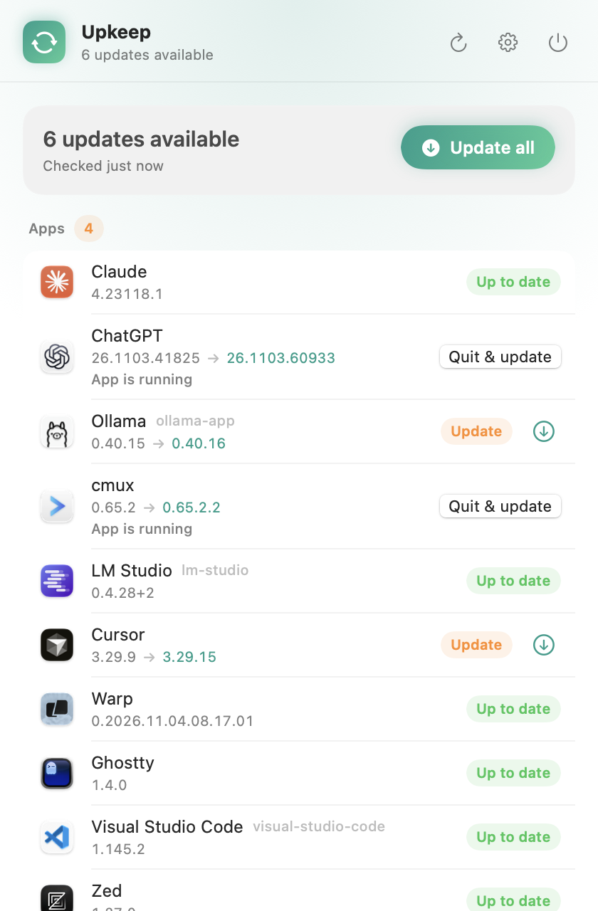

# upkeep

[](https://github.com/georgecristea/upkeep/actions/workflows/ci.yml)
[](https://github.com/georgecristea/upkeep/releases/latest)


[](LICENSE)

**Keep a curated list of Mac apps and command-line tools up to date, and verify every update.**

You list the programs you care about once: desktop apps from Homebrew casks, CLIs from npm,
Homebrew formulae, and tools that update themselves. `upkeep update` brings them all to the latest
version without prompts, then checks each app's code signature, its pinned Apple Team ID, and
Gatekeeper before calling the update done.

<p align="center"></p>

Two parts, one repo:

- **`upkeep` CLI.** One TypeScript file, zero dependencies, run directly by Node. This is the engine.
- **Upkeep.app.** A menu bar companion that shows how many updates are waiting, with per-app
  buttons, Update all, notifications and the run log. It only ever calls the CLI.

## Install the CLI

Requires macOS, [Homebrew](https://brew.sh), and Node 22.18 or newer (`brew install node`).

```sh
git clone https://github.com/georgecristea/upkeep.git
cd upkeep
mkdir -p ~/.local/bin
ln -s "$PWD/bin/upkeep" ~/.local/bin/upkeep    # make sure ~/.local/bin is on your PATH
upkeep add <id>                                # e.g. ghostty, @openai/codex, gh
upkeep check
```

The launcher uses Homebrew's `node` (`/opt/homebrew/bin` or `/usr/local/bin`); set `UPKEEP_NODE`
to use another one.

## Use

```
upkeep check                 # installed vs latest, no changes; exit 1 if anything is outdated
upkeep update                # update everything that is outdated
upkeep update cursor gh      # only these (ids as listed)
upkeep update --force        # also quit running apps, update them, and reopen them afterwards
upkeep update --dry-run      # show what would happen
upkeep add <id>              # add a Homebrew cask, npm package, or Homebrew formula
upkeep remove <id>
upkeep list
upkeep log                   # latest update log
upkeep schedule install [--at=HH:MM] | remove | status
```

Running apps are skipped unless you pass `--force`. A forced run quits the app, updates it,
verifies it, and reopens it in the background when the run finishes.

## What it tracks

Your list lives in `upkeep.json` next to `upkeep.ts`. It's created empty on first run and is not
tracked by git. [`upkeep.example.json`](upkeep.example.json) shows one entry of each kind.

| kind      | what it is                              | updated with                                  |
|-----------|-----------------------------------------|-----------------------------------------------|
| `cask`    | a desktop app, via Homebrew cask        | `brew upgrade --cask --greedy`                |
| `npm`     | a CLI published to npm                  | `npm install -g <pkg>@<version>`              |
| `formula` | a Homebrew formula                      | `brew upgrade`                                |
| `native`  | a tool that updates itself              | the `update` argv you give it, e.g. `claude update` |

`upkeep add <id>` works out the kind for you. For an app, it reads the Team ID from the copy
installed in `/Applications`, so install the app first.

> [!WARNING]
> If you edit `upkeep.json` by hand, list only apps you have: `update` installs any listed cask
> that isn't installed yet. Don't copy the example list wholesale.

## Security

- Never runs `sudo`, never opens a shell, never reads stdin. Every subprocess is
  `spawn(binary, argv)` with binaries pinned to absolute paths. Anything that would prompt fails
  instead.
- **Apps:** Homebrew verifies the SHA-256 in the cask. After every app update, upkeep runs
  `codesign --verify --deep --strict`, checks the Team ID against your list, and runs
  `spctl --assess` (Gatekeeper / notarization). Any mismatch fails the run loudly. `add` refuses
  unsigned apps and `.pkg` casks that would need `sudo`.
- **npm:** the registry must be `https://registry.npmjs.org/`. `npmMinReleaseAgeHours` (default 24)
  skips versions younger than that, so a hijacked release that gets pulled within hours never lands.
- A lock file prevents overlapping runs. Every update run writes a full log to
  `~/Library/Logs/upkeep/` and posts a macOS notification with the outcome.

Found a security problem? See [SECURITY.md](SECURITY.md).

### macOS App Management

macOS protects app bundles from changes by processes that didn't install them. upkeep doesn't
need that permission: replacing an app with `brew install --force` / `brew upgrade` works without
it. Homebrew's `--adopt` is deliberately not used, because it chmods the existing bundle, which this
protection refuses.

If an update ever fails with "Operation not permitted", macOS is blaming the terminal app you ran
upkeep from (Terminal, iTerm, Ghostty, …), not upkeep itself. Enable App Management for that
terminal app only.

## The menu bar app

Download **Upkeep.dmg** from the [latest release](https://github.com/georgecristea/upkeep/releases/latest),
or build it from the clone:

```sh
./scripts/install.sh   # build, package, install to /Applications, relaunch
```

Release builds aren't notarized yet, so open the app once with **System Settings → Privacy &
Security → Open Anyway** (or `xattr -dr com.apple.quarantine /Applications/Upkeep.app`).

The app needs the CLI installed at `~/.local/bin/upkeep` (see above). It checks on launch and every
6 hours by default; checks are read-only and nothing is installed until you click. Running apps
show a **Quit & update** button; **Update all** never quits anything. Click several rows in a row:
while one updates, the others queue (with a cancel control) and run next. Notifications carry an
"Update all" action. Settings, the latest log, and About live inside the popover.

## Scheduling

Off by default. `upkeep schedule install --at=04:00` writes a LaunchAgent that runs
`upkeep update --force --quiet` daily; launchd runs a missed job at the next wake.

## Development

```sh
swift build                                # the app
.build/debug/Upkeep --snapshot out.png     # render the popover offscreen to a PNG
.build/debug/Upkeep --icon out.png         # every menu bar icon state at 4x
node upkeep.ts help                        # the CLI, straight from the clone
```

`--screen settings|log|about` picks another screen for `--snapshot`. Design notes:
[docs/cli-design.md](docs/cli-design.md) and [docs/app-design.md](docs/app-design.md).
[CLAUDE.md](CLAUDE.md) has the build notes and gotchas, for humans and coding agents alike.
The UI is built on [MacUtilityKit](https://github.com/georgecristea/MacUtilityKit), shared with
[VoxKey](https://github.com/georgecristea/VoxKey) and [ClipVault](https://github.com/georgecristea/ClipVault).
See [CONTRIBUTING.md](CONTRIBUTING.md).

## License

[MIT](LICENSE) © DeepDive Solna AB. Made by [George Cristea](https://github.com/georgecristea).
